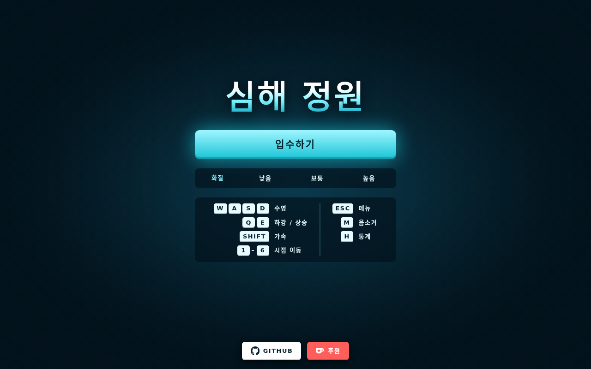
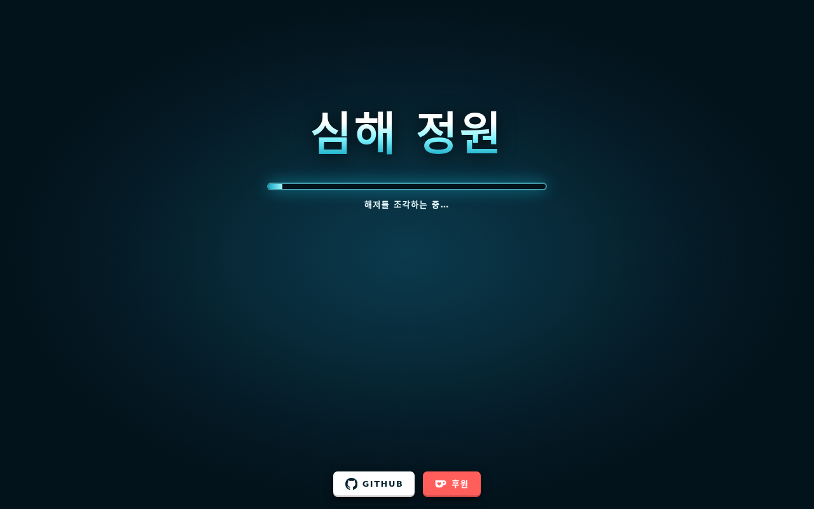
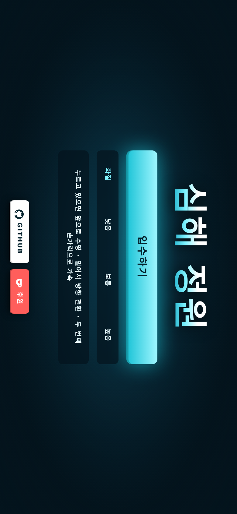

# 심해 정원 (Abyssal Garden) — 비공식 한글판

**브라우저에서 바로 헤엄쳐 다닐 수 있는 몽환적인 수중 세계입니다.**

출렁이는 다시마 숲, 물결치는 수면으로 쏟아지는 햇빛, 침몰한 배, 머리 위를 미끄러지듯 지나가는 쥐가오리.
이 모든 것이 코드로 만들어집니다: 이미지도, 3D 모델도, 음원 파일도 없습니다. 세계 전체가 **단 하나의 97KB HTML 파일**에 들어 있습니다.

이 저장소는 [Noniv](https://github.com/Noniv)의 [Abyssal Garden](https://github.com/Noniv/abyssal-garden)을 한국어로 옮긴 비공식 한글판입니다. 원작의 분위기와 조작을 그대로 유지하면서 화면의 모든 문구를 한국어로 다듬었습니다.



## 실행하기

1. [`index.html`](index.html)을 내려받습니다.
2. 데스크톱 컴퓨터의 **Chrome** 또는 **Edge**에서 엽니다.
3. 세계가 만들어질 때까지 몇 초 기다린 뒤 **입수하기**를 눌러 수영을 시작합니다.

설치할 것이 없고 오프라인에서도 동작합니다. **WebGPU**를 지원하는 브라우저가 필요합니다. *"이 장면에는 WebGPU가 필요합니다"*라는 안내가 보이면 브라우저를 업데이트하거나 Chrome / Edge로 바꿔 주세요.

## 수중 세계의 모습

- 조류에 흔들리며 금색·녹색 입자로 반짝이는 **다시마 숲**
- 물결치는 수면에서 쏟아지는 **빛줄기**와 해저에 일렁이는 코스틱스
- **침몰한 목조선**, 거대한 **돌 고래 꼬리**, 바위 아치, 협곡, 떠다니는 바위
- **쥐가오리**, 물고기 떼, 솟아오르는 거품, 떠다니는 입자
- 자주색으로 빛나는 지피식물, 산호, 통 모양 해면이 가득한 **보라색 동굴**
- 듣는 순간 만들어지는 **사운드스케이프**: 낮은 울림, 멀리서 들리는 고래 울음, 은은한 종소리와 거품 소리

| | |
|---|---|
|  |  |
|  |  |


## 조작법

| | 키보드 & 마우스 |
|---|---|
| 둘러보기 | 마우스 움직임 |
| 수영 | `W` `A` `S` `D` |
| 상승 / 하강 | `E` / `Q` |
| 가속 | `Shift` 길게 |
| 시점 이동 | `1` ~ `6` (스크린샷 속 장소들) |
| 메뉴 | `Esc`를 누르면 마우스가 풀리고 조작법 메뉴가 열립니다. **계속하기**로 돌아갑니다 |
| 소리 켜기 / 끄기 | `M` (입수하면 소리가 시작됩니다) |
| 성능 통계 | `H` |
| 화질 | 메뉴의 **낮음**, **보통**, **높음** (페이지가 새로고침됩니다) |

해저, 절벽, 아치는 단단합니다: 바위를 뚫고 들어가는 대신 미끄러지듯 지나가고, 모든 터널과 아치는 통과할 수 있습니다. 다시마, 식물, 산호, 해면, 흩어진 돌, 떠다니는 바위, 배, 고래 꼬리는 지나갈 수 있습니다.

**터치스크린:** 한 손가락을 누르고 있으면 앞으로 수영하고, 밀어서 방향을 바꿉니다. 두 번째 손가락을 대면 빨라집니다. 모서리의 `≡` 버튼으로 메뉴를 엽니다. 휴대폰에서는 항상 가로 화면으로 표시되고 낮음 또는 보통 화질로 시작합니다. (터치 지원은 실험적입니다.)

| 한글판 로딩 화면 | 한글판 모바일 메뉴 |
|---|---|
|  |  |

## 화질 단계

메뉴의 **낮음**, **보통**, **높음** 버튼으로 화질을 고르며 현재 단계가 밝게 표시됩니다. 모든 단계는 같은 세계를 담은 양만 줄여 만듭니다.

| 단계 | 내용 | 첫 방문 시 선택되는 기기 |
|---|---|---|
| **높음** | 전체 장면 | 컴퓨터 |
| **보통** | 잎, 반짝임, 자갈이 절반; 작은 바위·해면·산호는 그림자 없음 | 메모리 8GB 휴대폰 |
| **낮음** | 잎이 1/4, 안티앨리어싱 없음, 거친 바위·산호, 간단한 조명, 480p로 시작 | 그 외 휴대폰, 메모리 4GB 이하 컴퓨터 |

로딩 중 탭이 멈추거나 그래픽 드라이버가 포기하면 한 단계 낮춰 다시 시작합니다. 브라우저는 다음 방문을 위해 화질 단계와 장면이 안정된 해상도·표시 거리를 기억합니다.

## 작동 원리

- 해저는 페이지를 열 때마다 그래픽 카드에서 조각된 뒤, 약 200만 장의 다시마 잎과 식물, 수만 개의 바위, 수천 개의 해면·산호·물고기로 장식됩니다.
- 모든 것을 **WebGPU**로 직접 그립니다. 게임 엔진이나 3D 라이브러리를 쓰지 않습니다.
- 배, 고래 꼬리, 쥐가오리, 물고기, 산호는 간단한 수학적 도형으로 만듭니다.
- 소리는 Web Audio API로 실시간 합성합니다.
- 부드럽게 동작하도록 만들었습니다: RTX 5070 Ti에서 2560×1440으로 약 180fps. 느린 기기에서는 해상도를 먼저, 그다음 식물과 바위의 표시 거리를 조금씩 낮춰 60fps를 노립니다. 시작 메뉴 뒤에서 장면이 흐릿하게 이미 돌아가고 있어, 입수 전에 대부분의 조정이 끝납니다. 저사양 휴대폰(Samsung Galaxy A16)은 낮음에서 670×372로 약 20fps에 도달합니다.

## 직접 바꿔 보기

읽기 좋은 소스 코드는 [`source`](source) 폴더에 있습니다. 무언가 바꾸고 `index.html`을 다시 빌드하려면 [Node.js](https://nodejs.org) 18 이상이 필요합니다:

```bash
cd source
npm install
npm run build
```

이 명령은 이 README 옆에 새 `index.html`을 만듭니다. `npm run build:readable`은 축소되지 않은 버전을 만들어 브라우저 개발자 도구에서 디버그하기 쉽습니다.

## 한글화 참고

- 제목, 메뉴, 조작법 안내, 화질 버튼, 로딩 문구, 오류 안내, 성능 통계 등 화면의 모든 영어 문구를 한국어로 옮겼습니다.
- 한국어 줄바꿈이 단어 중간에서 끊기지 않도록 메뉴 문구에 `word-break: keep-all`을 더했습니다.
- 세계 생성·렌더링·사운드 코드와 조작, 화질 단계, 판정 등 게임 동작은 원작과 같습니다.
- 원작의 GitHub 링크와 후원(ko-fi) 링크는 그대로 둡니다.

## 라이선스 및 원작

- 원작: **Abyssal Garden** by Maksymilian Dendura (Noniv) — https://github.com/Noniv/abyssal-garden
- 라이선스: [MIT](LICENSE). 사용, 수정, 공유가 자유이며 여러분의 프로젝트에도 쓸 수 있습니다.
- 이 한글판은 원작자와 무관한 비공식 번역입니다. 원작의 영어 README는 [README.en.md](README.en.md)에 그대로 보존되어 있습니다.
